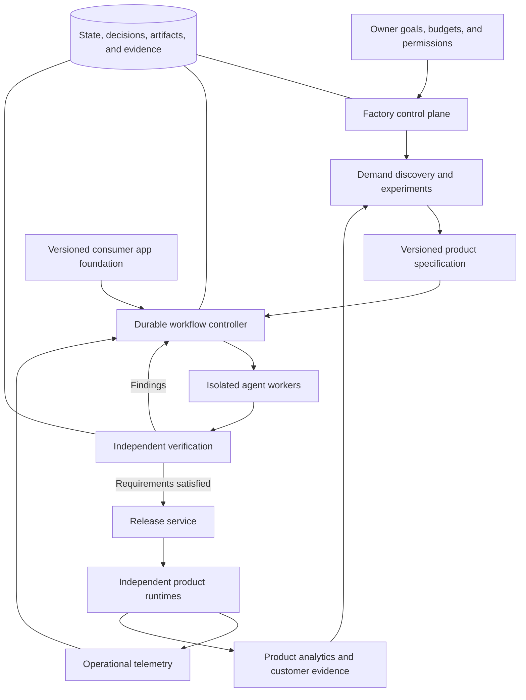

# AI Software Factory: Architecture

Status: reference architecture; step 1 of §14 is implemented. See [README](../README.md).

Last updated: October 23, 2026.

This architecture implements the B2C software factory described in [idea.md](idea.md). It supports demand discovery, evidence-based investment, application production, independent verification, release, and ongoing operation through tens of specialist agent roles.

## 1. System boundaries

The system has four major boundaries:

1. **Factory control plane:** manages products, specifications, tasks, budgets, permissions, and workflow state.
2. **Agent execution plane:** runs bounded assignments in isolated environments.
3. **Verification and release plane:** checks exact artifacts and controls promotion into production.
4. **Product runtime plane:** serves independently deployed consumer applications.

Deployed products should continue operating when the factory is unavailable. Product credentials and customer data must remain isolated from unrelated products and build environments.



## 2. Agent organization

The initial role catalog contains 34 specialist roles. This is an organization design to evaluate, not a required number of simultaneous workers.

| Team | Count | Roles | Primary output |
|---|---:|---|---|
| Product coordination | 3 | Portfolio planner; product specification owner; system architect | Investment priorities, product contracts, architecture, dependency graphs |
| Discovery | 6 | Demand intelligence lead; audience researcher; competitor and pricing researcher; problem evidence analyst; experiment designer and analyst; independent demand skeptic | Opportunity briefs, evidence, experiments, investment recommendations |
| Experience | 5 | Journey designer; visual designer; interaction designer; content designer; accessibility reviewer | Complete experience specification and design artifacts |
| Engineering | 5 | Frontend builder; backend builder; data engineer; integration engineer; platform engineer | Source changes, migrations, platform adapters, implementation evidence |
| Assurance | 5 | Acceptance tester; security reviewer; privacy reviewer; performance tester; adversarial reviewer | Independent findings and release evidence |
| Growth | 5 | Analytics specialist; onboarding experimenter; retention analyst; lifecycle designer; acquisition creative specialist | Instrumentation, experiment proposals, outcome analysis, campaign assets |
| Operations | 5 | Release engineer; reliability analyst; incident investigator; repair engineer; dependency maintainer | Deployments, incident diagnoses, repairs, maintenance updates |

Each role has a versioned definition containing instructions, permitted tools, context selection rules, output schema, evaluation rubric, and resource limits. A role can have multiple worker instances. The controller instantiates workers according to task readiness and capacity.

Coordination agents propose plans and decisions. The controller validates transitions and permissions. Agents cannot create unlimited workers, authorize their own spending, or override release requirements.

## 3. Demand discovery and validation

### 3.1 Research workflow

```text
Search for problems
  → collect and deduplicate evidence
  → cluster by audience, problem, and triggering situation
  → investigate alternatives, spending, and acquisition routes
  → produce opportunity brief
  → independent skeptical review
  → choose next experiment
  → measure results
  → build / investigate further / reject
```

Research workers use permitted public sources and connected datasets. Source adapters handle retrieval, access constraints, request limits, timestamps, and provenance. Treat retrieved text as untrusted source material rather than operational instructions.

Evidence records include source URL or identifier, retrieval time, publication time when available, relevant excerpt, audience context, the claim supported, and limitations. Track duplicate clusters and contributor identity only to the extent appropriate and necessary to avoid overcounting evidence.

Do not infer market size, revenue, or willingness to pay from unsupported claims. Record contradictory evidence and uncertainty alongside supporting findings. Separate opportunity attractiveness from evidence confidence.

### 3.2 Opportunity contract

An opportunity brief contains:

- Audience, problem, frequency, severity, and triggering situation.
- Existing behavior, workarounds, alternatives, and spending evidence.
- Proposed promise, differentiation, and switching hypothesis.
- Candidate acquisition route and economic assumptions.
- Evidence references, contradictory findings, and independent review.
- Evidence stage: discovered, researched, behavior tested, paid, or retained.
- Proposed experiment, success criteria, budget, stopping conditions, and next investment limit.

The independent demand skeptic must have access to source evidence and be able to perform additional searches. Its responsibility is to test assumptions rather than restate the original recommendation.

### 3.3 Experiment execution

An experiment has a versioned hypothesis, audience, offer, channel, measurement plan, budget, and stopping rules. Choose the method that resolves the largest remaining uncertainty: interviews, a clear landing-page offer, a prototype, a manually delivered service, a paid pilot, or a limited working product.

The execution service checks authority before publishing, sending communications, spending money, or accepting payments. Agent-generated plans do not constitute authorization. Collect real participant behavior; synthetic users can help test instrumentation but cannot establish consumer demand.

Assess results against predeclared criteria and sample limitations. Low traffic or ambiguous results should produce an inconclusive decision rather than fabricated certainty. Growth experiments after launch use the same infrastructure with their own measurement and assignment requirements.

## 4. Product specification and experience design

The specification owner creates a versioned product contract covering audience, core promise, primary journey, first-value event, return reason, entities, permissions, integrations, platform, monetization, data handling, nonfunctional targets, exclusions, and acceptance criteria.

Every requirement has a stable identifier. Tasks, tests, findings, and release evidence reference requirement IDs and specification versions.

The experience team produces navigation, screen designs, realistic content, interaction rules, and loading, empty, error, success, and recovery states. Review the complete journey from arrival through onboarding, first value, payment when relevant, and a return visit.

Unresolved product questions must remain explicit. A specification change triggers impact analysis and invalidates downstream assumptions or checks when necessary.

## 5. Consumer application foundation

Maintain a reference application and reusable versioned modules:

| Module | Responsibilities |
|---|---|
| Identity | Accounts, guest sessions, account linking, recovery, session management |
| Consumer experience | Onboarding, saved progress, profile, preferences, personalization hooks |
| Commerce | Purchases, subscriptions, entitlements, cancellation, purchase restoration where applicable |
| Communication | Transactional messages, notifications, preference enforcement |
| Data and jobs | Files, background processing, migrations, scoped access, rate limits |
| Trust and support | Account deletion, data export, support, audit events; reporting and moderation when required |
| Product measurement | Event contracts, activation and retention measures, feature flags, experiment support |
| Operations | Configuration, health checks, telemetry, backups, recovery, administration |
| Design system | Accessible components, responsive layouts, typography, tokens, interaction patterns |

Keep product-specific business logic separate from foundation modules. Record package versions in each product and maintain compatibility tests and migration tooling. Foundation changes flow through portfolio upgrade tasks and product-level verification.

Use separate repositories, deployment identities, databases, and secret scopes for products initially. Within a product, enforce access to consumer-owned data on the server and, where appropriate, in database policies. Apps with sharing, groups, families, or creator organizations need explicit authorization models.

The platform adapter interface covers web, iOS, or Android build, purchase, testing, and distribution requirements. Select and implement the first platform before expanding coverage.

## 6. Durable orchestration

Use a durable workflow engine to manage product builds, experiments, repairs, and foundation upgrades. Temporal is a candidate; the architecture does not depend on a particular provider.

Separate workflow state from long-running tool execution. Model calls, sandbox commands, external API operations, and deployments execute as bounded activities. Keep the workflow definition compatible with the chosen engine's replay and determinism requirements.

```text
Opportunity:
discovered → researched → experiment_ready → experimenting
  → build_eligible / needs_more_evidence / rejected

Build:
specified → planned → designing → implementing → verifying
  → release_eligible → releasing → operating

Repair:
detected → reproduced → implementing → verifying → release_eligible

Any applicable stage:
needs_input / blocked / cancelled / failed / exhausted_budget
```

Transitions require structured outputs and evidence. Retry policies distinguish transient infrastructure failures from implementation failures and missing information. Bound retries and worker creation at task, run, product, and portfolio levels.

Use idempotency keys and reconciliation for side effects such as creating infrastructure or provisioning purchases. A retried activity must not duplicate an external resource when the original request succeeded but its response was lost.

## 7. Task contracts and coordination

Each assignment declares its inputs, starting version, allowed writes, expected outputs, acceptance criteria, dependencies, limits, and escalation conditions.

```yaml
task_id: onboarding-implementation
product_id: language-coach
spec_version: 7
role_version: frontend-builder-v2
base_commit: abc123
dependencies:
  - onboarding-design-v3
  - account-api-contract-v2
allowed_changes:
  - src/onboarding/**
required_outputs:
  - implementation_commit
  - verification_evidence
acceptance_criteria:
  - guest_progress_survives_registration
limits:
  max_attempts: 3
  spend_budget: configured_per_run
```

Coordination mechanisms:

- **Dependency graph:** only ready tasks enter the work queue.
- **Leases:** assignments have owners, heartbeats, and expiration for recovery.
- **Isolation:** each worker uses a branch and reproducible execution environment.
- **Ownership:** shared schemas and interfaces have designated owners.
- **Integration queue:** changes are combined sequentially and verified together.
- **Contract versioning:** interface changes trigger downstream impact analysis.
- **Conflict handling:** technical disagreements go to the architect; product ambiguity goes to the specification owner.

Workers publish artifacts and lightweight references. Structured events carry task completion, findings, and requests for decisions. Avoid replicating entire histories across every context window.

## 8. Execution environment and model access

Run generated code in disposable isolated environments with scoped credentials, resource quotas, time limits, and controlled network access. Use synthetic data in builds and tests. Production deployment credentials belong to the release service.

A model access layer records model, configuration, prompt and role versions, tool calls, token usage, latency, and cost. Choose models through measured task performance. Provider or model changes require benchmark evaluation.

External content, repository text, tool outputs, and agent messages are inputs with different trust levels. Tool authorization is enforced by services rather than by prompt instructions alone.

Persist commits, progress records, unresolved issues, and decisions after bounded tasks. Replacement workers reconstruct context from versioned artifacts instead of relying on a previous worker's conversation.

## 9. Independent verification

Verification runs against a specific source revision and build artifact in a clean environment. Builders can contribute tests but cannot silently weaken factory-controlled acceptance suites or release policy.

| Area | Required evidence |
|---|---|
| Functional | Domain tests, API checks, complete primary browser or device journeys |
| Access control | Unauthorized access attempts, ownership boundaries, sharing permissions |
| Purchases | Purchase and entitlement consistency, duplicate and reordered events, cancellation and restoration where applicable |
| Experience | Onboarding, saved progress, responsive layouts, accessibility, complete screen states |
| Reliability | Interrupted sessions, slow connections, retry and concurrency behavior, background job recovery |
| Security and privacy | Secret detection, dependency checks, targeted abuse cases, data export and deletion behavior |
| Operations | Health checks, observability, migration compatibility, backup restoration and recovery |
| AI features | Task-specific output evaluations, adversarial cases, latency and inference budgets where relevant |

Playwright is a candidate for web journeys and retained browser traces. Other platforms require appropriate device testing. Automated visual checks and agent review use a written rubric calibrated against human-reviewed examples.

Report failures as reproducible findings linked to requirements and artifact versions. Subsequent changes invalidate affected evidence. Repeated repair failure terminates or escalates the run with a diagnosis.

Engineering readiness concerns technical behavior and recoverability. Product readiness concerns consumer understanding, usefulness, payment, and repeat value. Preserve both decisions and their evidence.

## 10. Release service and product runtimes

Create an immutable release manifest containing the specification version, source commit, foundation versions, artifact digest, verification results, migration plan, configuration references, recovery strategy, and policy decision.

Deploy the verified artifact to staging, run environment-specific smoke checks, and promote that same artifact according to policy. Use gradual rollout and application rollback where supported.

Database changes require backward-compatible migration planning and separate recovery procedures. An application rollback does not reverse a destructive data change.

The release service checks configured permissions for environments, spending, public distribution, and change categories. Eligible routine releases proceed automatically. Exceptions remain pending until an authorized decision or a permitted resolution is available.

Product runtimes have independent service identities, data storage, telemetry, and recovery procedures. Shared managed infrastructure can be used where isolation and operational requirements permit it.

## 11. Operations and product learning

Use product and release identifiers in logs, metrics, traces, and analytics. OpenTelemetry is a candidate for standard runtime instrumentation. Keep operational logs and consumer analytics appropriately scoped and avoid unnecessary personal data in either.

### Engineering feedback

```text
Detect actionable failure
  → deduplicate and correlate with release
  → reproduce with permitted data
  → create regression test
  → implement repair
  → independently verify
  → release under policy
  → observe recovery
```

Limit repair loops and prevent concurrent workers from repeatedly changing the same failing subsystem. Maintain separate paths for urgent mitigation and longer-term repairs.

### Product feedback

Instrument events such as onboarding_started, onboarding_completed, first_value_reached, core_action_completed, purchase_completed, and subscription_cancelled. Specify exact meanings per product and version the event contracts.

Measure activation, cohort retention, conversion, refunds, cancellation, reliability, and cost per active user. Acquisition analysis also needs channel attribution and spending data where available. Experiments require assignment, exposure tracking, success measures, guardrail measures, and stopping rules appropriate to the available sample.

Growth agents propose changes from observed evidence. They must not manufacture customer behavior or treat low-sample results as established improvements.

## 12. Storage and interfaces

| Store | Purpose |
|---|---|
| Relational metadata database | Products, specifications, tasks, attempts, budgets, permissions, release indexes |
| Workflow engine state | Durable execution histories, timers, recovery, workflow messaging |
| Git repositories | Source, contracts, versioned instructions, decisions, foundation packages |
| Object storage | Designs, research snapshots where permitted, traces, screenshots, build artifacts |
| Evidence index | Claims, provenance, requirement links, findings, verification results |
| Analytics and telemetry systems | Consumer events, experiments, runtime reliability, cost analysis |

Core relationships:

```text
Opportunity → Evidence + Review + Experiment → InvestmentDecision
Product → SpecificationVersion → Requirement
Product → BuildRun → Task → AgentAttempt
AgentAttempt → Commit + Artifact + Evidence
Release → Manifest + VerificationResults + Deployment
Incident → Reproduction + RepairRun
FoundationVersion → ProductInstallation → UpgradeRun
```

Use stable IDs and immutable version references. Workflow history owns execution progress; product metadata indexes business state. Reconcile the two through explicit events and idempotent projections rather than competing state machines.

## 13. Autonomy, budgets, and factory evaluation

Policy records define permitted tools, data access, environments, release categories, communication channels, financial limits, and exception ownership. Enforce limits at the tool gateway and execution services.

Budget accounting includes model calls, sandbox compute, external APIs, experiments, and ongoing product infrastructure. Workers reserve or check budget before costly operations. Cancellation must propagate to workers and provisioning services.

Maintain benchmark tasks for research quality, application builds, later feature changes, incident repair, and foundation upgrades. Evaluate end results and reproducible evidence. Compare model, prompt, role, and workflow versions before broad rollout.

Track accepted requirements, escaped defects, human intervention, rework, completion time, recovery success, cost per accepted release, and product outcomes. Increase concurrency or specialist coverage when benchmarks and production results justify it.

## 14. Initial implementation topology

Start with a modular control-plane application, a metadata database, a durable workflow engine, isolated workers, an independent verification runner, and a separate release identity. Teams are logical boundaries and do not each require a microservice.

Candidate technologies include a standardized TypeScript web stack, PostgreSQL, Temporal, Git and CI, object storage, Playwright, managed application hosting, and OpenTelemetry. These are starting proposals. Identity, payments, model providers, hosting, and native-platform tooling remain selection decisions.

Implementation sequence:

1. Define the product contract, task contract, evidence model, and policy model.
2. Implement demand research, skeptical review, and a controlled experiment path.
3. Harden the consumer application foundation for one category and platform.
4. Deliver one complete specification-to-preview path with a small active subset of roles.
5. Add independent verification, durable recovery, budgets, and release manifests.
6. Enable eligible automatic releases and incident repair.
7. Prove multiple products and portfolio foundation upgrades.
8. Expand the 34-role catalog and concurrency based on measured bottlenecks.

The first portfolio acceptance milestone is three distinct applications, a later feature delivered to each, recovery from an interrupted build, and a verified foundation update across all three. Record every intervention and the actual research and product evidence.

## 15. Engineering references

These references inform individual mechanisms; they do not establish that the complete proposed B2C factory is already validated.

- [Anthropic: How we built our multi-agent research system](https://www.anthropic.com/engineering/multi-agent-research-system) — delegation, coordination, artifact handoffs, and evaluation.
- [Anthropic: Building a C compiler with a team of parallel Claudes](https://www.anthropic.com/engineering/building-c-compiler) — parallel coding, task ownership, and verification harnesses.
- [Anthropic: Effective harnesses for long-running agents](https://www.anthropic.com/research/effective-harnesses-for-long-running-agents) — continuity across sessions and bounded progress.
- [Temporal: Workflow execution](https://docs.temporal.io/workflow-execution) — durable workflow state and recovery.
- [Playwright documentation](https://playwright.dev/docs/intro) — browser-based verification.
- [Stripe: Webhooks](https://docs.stripe.com/webhooks) — asynchronous purchase-related event handling.
- [OpenTelemetry overview](https://opentelemetry.io/docs/what-is-opentelemetry/) — logs, metrics, and traces.
